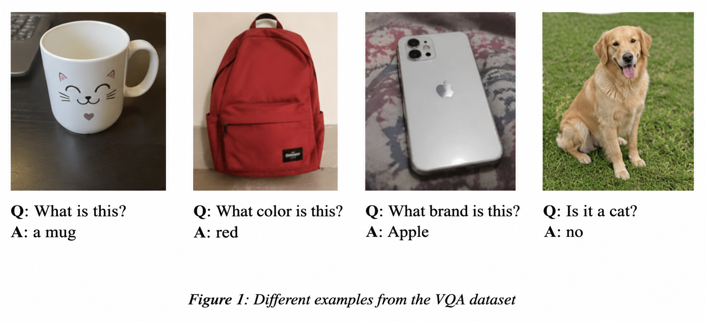
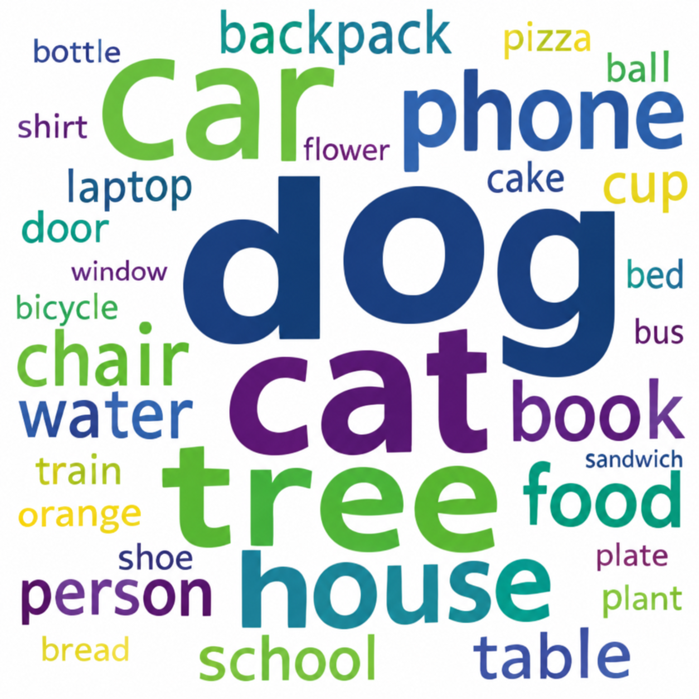
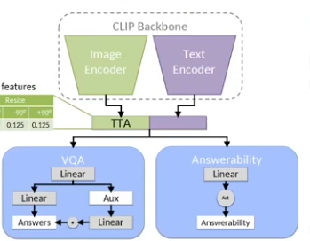
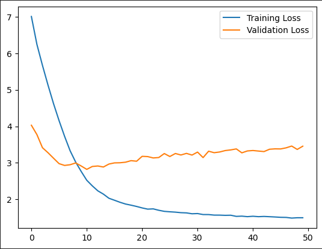
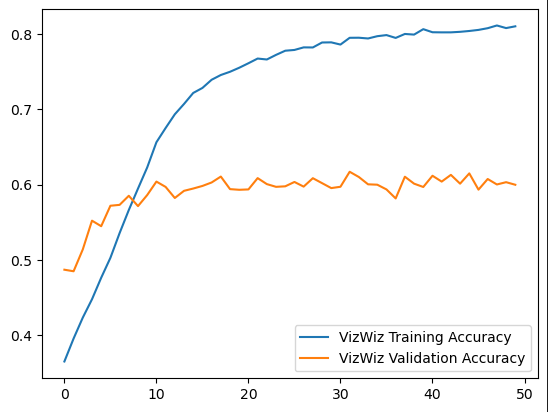
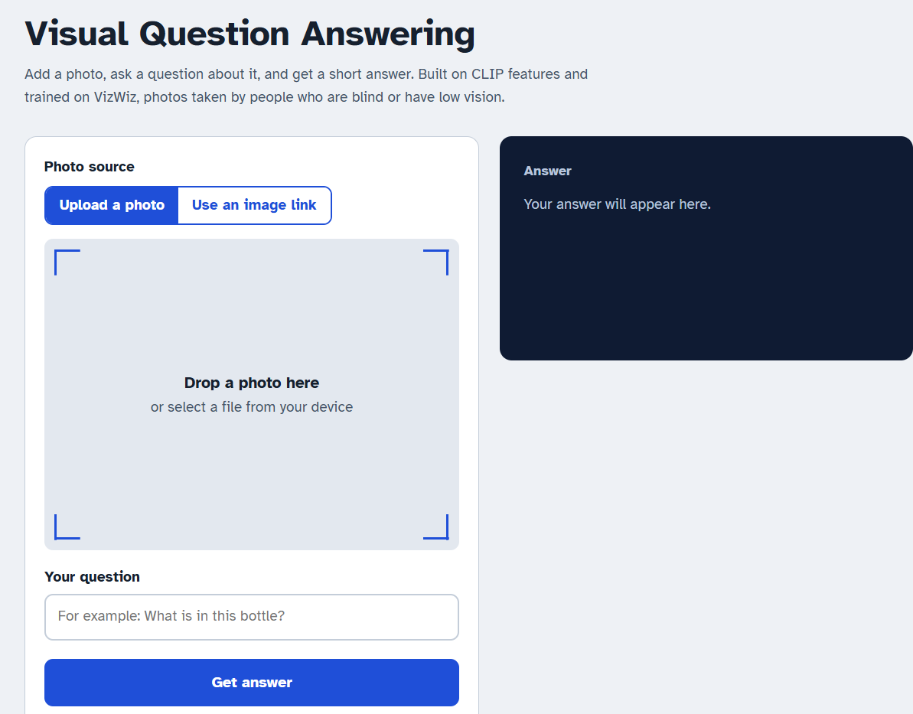

# Visual Question Answering

Welcome to my Visual Question Answering (VQA) project! The goal is to build a system that can answer natural-language questions about images, using pretrained multimodal features and a lightweight deep learning model. The project uses the [VizWiz](https://vizwiz.org/tasks-and-datasets/vqa/) dataset, which contains real-world photos taken by people who are blind or have low vision, along with their questions. A Flask web application lets you upload an image (or paste an image link), ask a question, and see the model's prediction.

> [!NOTE]
> This is an adapted project, undertaken for learning and study purposes. It is based on the original [yousefkotp/Visual-Question-Answering](https://github.com/yousefkotp/Visual-Question-Answering) repository and the [Less Is More](https://arxiv.org/abs/2206.05281) paper. Full credit for the original work goes to its authors (see [Credits](#credits)).

<p align="center">
  
</p>

## Table of Contents

- [Our Approach](#our-approach)
- [Dataset](#dataset)
  - [Data Exploration](#data-exploration)
  - [Data Splitting](#data-splitting)
  - [Data Preprocessing](#data-preprocessing)
- [Model Architecture](#model-architecture)
- [Training](#training)
  - [Loss Graphs](#loss-graphs)
  - [Accuracy Graphs](#accuracy-graphs)
- [Evaluation](#evaluation)
  - [Results](#results)
- [Web Application](#web-application)
  - [User Interface](#user-interface)
- [Deployment](#deployment)
  - [Using Docker](#using-docker)
  - [Using Python](#using-python)
- [Credits](#credits)
- [References](#references)

## Our Approach

This solution uses a **fixed vocabulary** approach, as discussed in the [Less Is More](https://arxiv.org/abs/2206.05281) paper. The model is not generative. Instead, it selects the answer from a predefined set of possible answers. This keeps the output limited to answers from a controlled vocabulary, and it needs far less computing power than training a full vision-language model.

The [CLIP](https://openai.com/blog/clip/) model extracts features from the image and the question, and these features are passed through linear layers to predict the answer.

Main technologies:

- [PyTorch](https://pytorch.org/) for building and training the model
- [CLIP](https://openai.com/blog/clip/) for image and text feature extraction
- [Scikit-learn](https://scikit-learn.org/stable/) for preprocessing and evaluation
- [Flask](https://flask.palletsprojects.com/) for the web application
- [Docker](https://www.docker.com/) for deployment

## Dataset

I used the [VizWiz](https://vizwiz.org/tasks-and-datasets/vqa/) dataset, a large-scale visual question answering dataset:

| Split | Image/Question Pairs | Answer/Confidence Pairs |
| ----- | -------------------: | ----------------------: |
| Training | 20,523 | 205,230 |
| Validation | 4,319 | 43,190 |
| Test | 8,000 | Hidden |

The dataset files are organized as follows:

- **Images:** training, validation, and test sets.
- **Annotations:** the visual questions are split into three JSON files (train, validation, test). Answers are public for the train and validation splits and hidden for the test split.
- The dataset is also available on [Kaggle](https://www.kaggle.com/datasets/lhanhsin/vizwiz).

### Data Exploration

I explored the dataset to understand its structure, question patterns, answer distributions, and answerability. The full analysis is in the [notebook](notebook.ipynb), so it is worth reading first. Here is an overview of the most frequent words in the training questions:

<p align="center">
  
</p>

### Data Splitting

I used the official training and validation splits provided by VizWiz. For additional experiments, a portion of the training set was randomly held out as a test set using scikit-learn's [`train_test_split`](https://scikit-learn.org/stable/modules/generated/sklearn.model_selection.train_test_split.html).

### Data Preprocessing

Each image-question pair has 10 human-provided answers. Following the paper, one answer is chosen as the training target using this policy:

1. Choose the most frequent answer among the 10 answers.
2. If there is a tie, choose the one that is most frequent across the entire set of answers.
3. If there is still a tie, choose the answer with the minimum Levenshtein distance to all tied answers.

Answers and answer types are then one-hot encoded with scikit-learn's [`OneHotEncoder`](https://scikit-learn.org/stable/modules/generated/sklearn.preprocessing.OneHotEncoder.html). The resulting answer vocabulary has **5,410** classes.

Instead of extracting features on the fly, the image and question embeddings are extracted once with [CLIP](https://openai.com/blog/clip/) and saved to disk, so feature extraction is not repeated in every epoch.

## Model Architecture

The architecture follows the [Less Is More](https://arxiv.org/abs/2206.05281) paper and works on top of the CLIP features:

- Each linear layer is Layer Normalization, then Dropout (p = 0.5), then a fully connected layer of size 512.
- The model has three prediction tasks:
  - **Answer prediction:** selects the answer from the 5,410-class vocabulary.
  - **Answer-type classification:** assigns the question to one of four answer types.
  - **Answerability prediction:** estimates whether the image-question pair can be answered.
- Cross-Entropy Loss is used for the answer and the answer type.
- Binary Cross-Entropy Loss is used for answerability.

<p align="center">
  
</p>

> [!NOTE]
> Dropout was removed from the answerability layer because it added a lot of noise to training that task.

## Training

The model was trained on Kaggle with a P100 GPU for 50 epochs. Checkpoints were saved every 5 epochs, and the best one was selected by validation accuracy. The best checkpoint came from **epoch 45**, which is the one used for evaluation.

| Parameter | Value |
| --------- | ----- |
| Platform | Kaggle |
| GPU | NVIDIA P100 |
| Epochs | 50 |
| Batch size | 32 |
| Optimizer | Adam |
| Learning rate | 5e-4 |
| L2 regularization | Not used |
| Best checkpoint | Epoch 45 |

### Loss Graphs

<p align="center">
  
</p>

### Accuracy Graphs

<p align="center">
  
</p>

## Evaluation

The model is evaluated with the metrics used in the [VizWiz VQA Challenge](https://vizwiz.org/tasks-and-datasets/vqa/):

- **VizWiz Accuracy:** the score for a predicted answer is `min(1, number of humans who gave that answer / 3)`.
- **Classification Accuracy:** the percentage of correctly predicted answer labels.
- **Answerability:** predicts whether a visual question can be answered, with a confidence score. It is measured with scikit-learn's [average precision](https://scikit-learn.org/stable/modules/generated/sklearn.metrics.average_precision_score.html), the weighted mean of precisions under the precision-recall curve.

### Results

| Metric | Training | Validation |
| ------ | -------: | ---------: |
| VizWiz Accuracy | 80.4% | 61.5% |
| Classification Accuracy | 76.4% | 48.0% |
| Answerability | 80.2% | 79.8% |

The gap between training and validation accuracy shows that the model overfits to some extent, which is expected for a fixed-vocabulary model on a small, noisy dataset like VizWiz.

## Web Application

[Flask](https://flask.palletsprojects.com/) powers a web application where you can:

- Upload an image or paste an image URL
- Type a natural-language question about the image
- See the predicted answer, the answer type, and how likely the question is to be answerable

The backend loads the trained PyTorch model (on CPU) together with the saved one-hot encoders and exposes a `/predict` endpoint that returns the prediction as JSON.

### User Interface

<p align="center">
  
</p>

## Deployment

You can run the application with Docker or with Python. Docker is recommended because it is easier to set up.

Before running, place these files in the `Saved_Models` folder:

- `model.pth` (the trained model checkpoint)
- `answer_onehotencoder.pkl`
- `answer_type_onehotencoder.pkl`

### Using Docker

1. Install [Docker](https://www.docker.com/).
2. Build the image:

   ```bash
   docker build -t vqa-flask-app .
   ```

3. Start the server:

   ```bash
   docker run -p 5000:5000 vqa-flask-app
   ```

   To use a different port, change the first number in the command above.

4. Open <http://localhost:5000/> in your browser.

### Using Python

1. Install the requirements:

   ```bash
   pip install -r requirements.txt
   ```

2. Set the Flask app.

   Windows:

   ```bash
   set FLASK_APP=app.py
   ```

   Linux / macOS:

   ```bash
   export FLASK_APP=app.py
   ```

3. Start the server:

   ```bash
   python -m flask run
   ```

4. Open <http://localhost:5000/> in your browser.

## Credits

- Adapted and documented by [Moneeba Abrar](https://github.com/aka-Trophy-Hunter) for learning and study purposes.
- Original project: [yousefkotp/Visual-Question-Answering](https://github.com/yousefkotp/Visual-Question-Answering) by [Yousef Kotp](https://github.com/yousefkotp), [Adham Mohamed](https://github.com/adhammohamed1), and [Mohamed Farid](https://github.com/MohamedFarid612).

## References

- [Less Is More: Linear Layers on CLIP Features as Powerful VizWiz Model](https://arxiv.org/abs/2206.05281)
- [CLIP: Connecting Text and Images](https://openai.com/research/clip)
- [Learning Transferable Visual Models From Natural Language Supervision](https://arxiv.org/abs/2103.00020)
